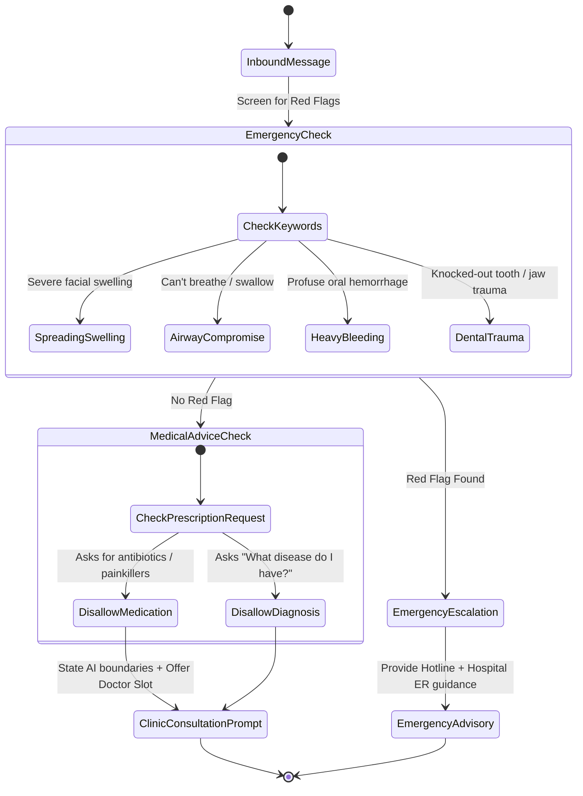
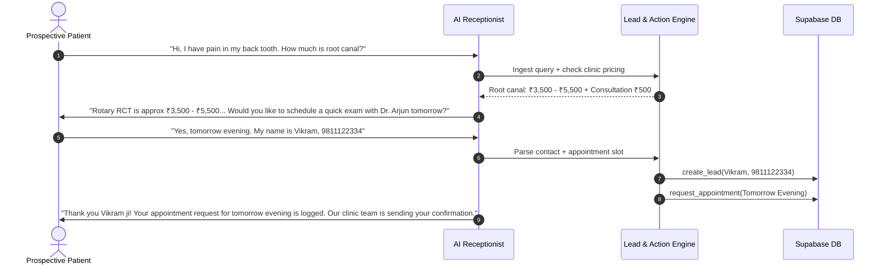

# AI Workflows & Automation Architecture — Clinic Growth AI

This document outlines the architecture, design principles, prompt engineering approach, guardrails, and automation engines powering the **Clinic Growth AI Receptionist and Follow-up System**.

---

## 1. System Overview & Architecture

The AI layer in Clinic Growth AI acts as an autonomous front-desk coordinator and revenue-protection system for dental practices. It operates 24/7 across website chat and WhatsApp to:
1. Answer patient FAQs on timings, location, services, doctors, and transparent pricing.
2. Capture prospective patient details (Name, 10-digit Phone, Primary Complaint).
3. Schedule appointment preferences and pass them directly to the clinic calendar.
4. Enforce strict medical safety boundaries (no diagnosis, no prescription, instant emergency escalation).
5. Drive intelligent multi-touch follow-ups and automated 24h / 2h reminders to reduce no-shows.

### Architecture Diagram

```mermaid
flowchart TD
    Patient([Patient via Web Chat / WhatsApp]) --> Ingest[Channel Ingestion Layer]
    Ingest --> SafetyScreen{Emergency & Red-Flag Screening}

    SafetyScreen -- "Red Flag Detected\n(Swelling, Bleeding, Trauma)" --> EmergencyProtocol[Immediate Emergency Advisory & Front-Desk Alert]
    SafetyScreen -- "Safe Clinical Query" --> ContextInjector[Clinic Context Injector\n(Hours, Doctors, Services, Pricing, FAQs)]

    ContextInjector --> ProviderRouter{AI Provider Router}
    ProviderRouter -- "API Key Present" --> GoogleAI[Google Gemini 1.5 Flash Provider]
    ProviderRouter -- "No Key / Demo Mode" --> MockAI[Mock Dental Receptionist Engine]

    GoogleAI --> ActionParser[Action & Structured Data Parser]
    MockAI --> ActionParser

    ActionParser --> DBWrite[(Clinic DB / Leads / Calendar)]
    ActionParser --> ResponseOut([Patient Response with Quick Reply Chips])
    
    DBWrite --> AutomationEngine[Follow-up & Reminder Engine]
    AutomationEngine --> WhatsAppChannel[WhatsApp / SMS Dispatch]
```

---

## 2. AI Provider Abstraction (`src/lib/ai/provider.ts`)

The AI engine uses an extensible, vendor-agnostic provider abstraction that enables zero-dependency operation in production while guaranteeing flawless offline demos.

```typescript
export interface AIProvider {
  generateResponse(messages: ChatMessage[], systemPrompt: string, options?: AIOptions): Promise<AIResponse>;
  generateStream(messages: ChatMessage[], systemPrompt: string, options?: AIOptions): AsyncGenerator<string>;
}
```

### Supported Providers:

1. **`GoogleAIProvider` (Production / Staging):**
   - Direct REST integration with Google Gemini (`gemini-1.5-flash`).
   - Built with native browser/Node `fetch` — **zero third-party SDK dependencies**.
   - Streams responses in real-time using Server-Sent Events (SSE).
   - Reads `VITE_GEMINI_API_KEY` from environment variables without exposing sensitive secrets in client bundles.

2. **`MockAIProvider` (Default / Demo):**
   - Enabled by default when no API key is configured.
   - Built-in heuristic intelligence for dental clinic inquiries (RCT, cleaning, implants, braces, timings, Sunday availability, Indian phone/name extraction, Hinglish queries).
   - Configurable realistic typing delay (150ms default) with character-chunked streaming support.

### Provider Factory & Auto-Detection:
`getAIProvider()` inspects available credentials:
```typescript
const provider = getAIProvider({ clinicContext });
// If VITE_GEMINI_API_KEY exists -> GoogleAIProvider
// If no key found -> MockAIProvider (Zero crashes, demo-ready)
```

---

## 3. Strict Safety Guardrails & Emergency Protocol

The highest priority in healthcare AI is patient safety and ethical liability protection. The AI Receptionist enforces hard limits:



### Safety Rules:
1. **Never Diagnose:** The AI never names a clinical pathology as definitive (e.g., will never say *"You have irreversible pulpitis"*).
2. **Never Prescribe:** The AI explicitly declines to suggest medications, antibiotics (e.g., Amoxicillin), or analgesics (e.g., Ketorolac, Ibuprofen).
3. **Mandatory Identity Disclosure:** Identifies itself clearly as "Aura, the digital assistant for [Clinic Name]".
4. **Emergency Escalation:** Triggers immediate `escalate` action, alerts front-desk staff, provides clinic emergency hotline, and instructs avulsed-tooth preservation steps (keep tooth in cold milk, visit within 30-60 mins).
5. **Human Handoff:** Whenever a patient expresses frustration or requests human assistance (*"receptionist se baat karni hai"*), the system flags the lead for human takeover.

---

## 4. Prompt Engineering Strategy (`src/lib/ai/prompts.ts`)

The prompt architecture uses dynamic context injection, strict role constraints, and machine-readable output contracts.

### Context Injection:
Every prompt dynamically integrates the clinic's real-time configuration:
- Operating hours (including specific Saturday/Sunday timings)
- On-duty MDS doctors, specializations, and slot availability
- Approved treatments with transparent starting prices and price ranges
- Approved clinic FAQs and insurance/payment policies

### Structured Action Extraction (`<action_data>`):
To avoid brittle external function calling schemas that differ across LLMs, the system instructs the AI to append an `<action_data>` block to its conversational response:

```json
<action_data>
{
  "leadData": {
    "name": "Rajesh Kumar",
    "phone": "9876543210",
    "concern": "Severe sensitivity on lower molar",
    "preferredDate": "Tomorrow",
    "preferredTime": "Evening 6:00 PM",
    "urgency": "high"
  },
  "actions": [
    { "type": "create_lead", "payload": { "name": "Rajesh Kumar", "phone": "9876543210" } },
    { "type": "request_appointment", "payload": { "date": "Tomorrow", "time": "Evening 6:00 PM" } }
  ],
  "shouldEscalate": false,
  "suggestedQuickReplies": ["Confirm 6:00 PM Slot", "Check Consultation Fee", "Directions to Clinic"]
}
</action_data>
```

The receptionist parser strips `<action_data>` from the patient-facing bubble while forwarding the JSON to the CRM and database.

---

## 5. Conversational Flows & Scenarios

### Flow A: New Patient Booking & Contact Capture



### Flow B: Hinglish & Multi-Language Support

Indian dental patients frequently mix Hindi and English:
> **Patient:** *"Dant me bahut dard hai kal se, kya doctor available hai shaam ko?"*  
> **AI:** *"Namaste! I am sorry to hear you are in pain. Yes, Dr. Arjun Mehta (Root canal specialist) is available tomorrow evening between 5:00 PM and 8:00 PM. May I know your name and mobile number to book your slot?"*

---

## 6. Automation & Multi-Channel Engagement

### Channel Abstraction (`src/lib/automation/channels.ts`):
Provides a unified interface across WhatsApp, Email, and SMS:
- `MockWhatsAppChannel`: Simulates WhatsApp Cloud API formatting, delivery status callbacks, and Indian mobile validations.
- `MockEmailChannel`: Transactional confirmation emails.
- `MockSMSChannel`: Simulates Indian TRAI/DLT 160-character segmented SMS dispatch.

### Follow-up Engine (`src/lib/automation/followup.ts`):
Prevents revenue leakage by automatically re-engaging patients who dropped off before booking:

```mermaid
flowchart TD
    LeadCreated[New Lead Inquired via AI Chat] --> CheckStatus{Booked within 2 Hours?}
    CheckStatus -- "Yes" --> CancelFollowup[Halt Automated Nudges]
    CheckStatus -- "No" --> OptOutCheck{Patient Opted Out / DND?}
    
    OptOutCheck -- "Opted Out (STOP)" --> AbortFollowup[Archive & Respect Privacy]
    OptOutCheck -- "Consented" --> StaffCheck{Staff Manually Intervened?}
    
    StaffCheck -- "Yes" --> PauseBot[Pause Automated Nudge\n(Avoid embarrassing collision)]
    StaffCheck -- "No" --> SendNudge[Generate AI Personalized WhatsApp Nudge]
    
    SendNudge --> WhatsAppDispatch[Dispatch via WhatsApp Channel]
```

### Standard Automated Follow-up Cadence:
1. **2 Hours Post-Inquiry:** Warm reminder offering 2 specific open slots for tomorrow.
2. **24 Hours Post-Inquiry:** Special check-in highlighting consultation availability.
3. **No-Show Recovery (2h post-missed slot):** Empathetic reschedule link.
4. **6-Month Preventive Recall:** Regular dental cleaning & checkup reminder.

### Appointment Reminders (`src/lib/automation/reminders.ts`):
- **24-Hour Reminder:** Sent via WhatsApp with interactive reply triggers (*"Reply 1 to confirm, 2 to reschedule"*).
- **2-Hour Reminder:** Sent with Google Maps navigation link, landmark directions, and parking details.
- **Post-Visit Review Request:** Dispatched 3 hours after appointment completion requesting a 5-star Google Review.

---

## 7. Production Roadmap & Integration Guide

To transition from the demo/mock engine to live production:

1. **WhatsApp Business API:** Connect Meta WhatsApp Cloud API or Gupshup/Wati BSP webhook to `src/lib/automation/channels.ts`.
2. **Google Gemini API:** Set `VITE_GEMINI_API_KEY` in environment variables.
3. **SMS Gateway:** Configure DLT Entity ID and Template IDs with Indian providers (Msg91 / Textlocal).
4. **Voice / IVR Receptionist Extension:** The prompt templates and triage rules in `src/lib/ai/prompts.ts` are 100% compatible with WebRTC / Twilio / Bland.ai voice telephony agents.
