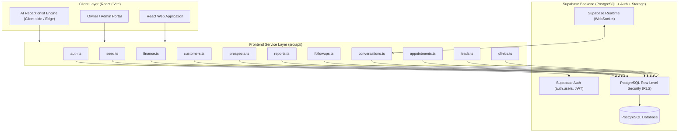
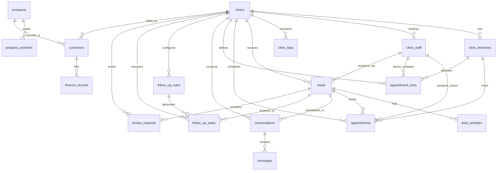

# Clinic Growth AI — Backend Architecture

## Overview
Clinic Growth AI utilizes **Supabase** (PostgreSQL, Auth, and Row-Level Security) as its unified backend architecture. There is no separate backend application server required for the MVP; frontend clients and AI/automation workers communicate directly with Supabase via `@supabase/supabase-js`, with isolation enforced at the database layer via PostgreSQL Row Level Security (RLS) policies.

---

## Entity Relationship Diagram (ERD)

---

## Database Schema Breakdown

### 1. Tenant / Clinic Domain
- **`clinics`**: Root multi-tenant entity storing name, slug, contact details, business hours, and JSON settings.
- **`clinic_branches`**: Physical facilities or satellite branches belonging to a clinic.
- **`clinic_staff`**: Clinic employees linked to Supabase Auth (`auth.users(id)`). Roles: `owner`, `admin`, `receptionist`, `doctor`.
- **`clinic_faqs`**: Knowledge base Q&A pairs utilized by both reception staff and the autonomous AI receptionist.

### 2. Lead Management Domain
- **`leads`**: Prospective dental patients with source tracking (`website`, `whatsapp`, `phone`, `walk_in`, `referral`, `ai_chat`) and funnel statuses (`new`, `contacted`, `interested`, `appointment_requested`, `appointment_confirmed`, `converted`, `lost`).
- **`lead_activities`**: Immutable audit logs of status transitions, notes, and staff outreach attempts.

### 3. Scheduling & Appointments Domain
- **`appointments`**: Patient bookings mapped to a clinic, lead, doctor, and physical branch. Tracked through `requested`, `confirmed`, `completed`, `cancelled`, `no_show`, `rescheduled`.
- **`appointment_slots`**: Weekly recurring availability templates by day of week (0=Sunday ... 6=Saturday) and time window. Used to dynamically compute bookable slots.

### 4. Omnichannel & AI Communications Domain
- **`conversations`**: Communication threads tagged by channel (`whatsapp`, `web_chat`, `email`, `phone`).
- **`messages`**: Individual messages with sender roles (`user`, `assistant`, `system`) and JSON metadata (token metrics, intent categorization, action payload).

### 5. Automated Follow-ups & Reputation Management
- **`follow_up_rules`**: Configurable automated reminders with delay timers, event triggers, and templated messages.
- **`follow_up_tasks`**: Scheduled asynchronous execution queue with attempt counters and delivery statuses.
- **`review_requests`**: Post-visit feedback requests capturing 1–5 star ratings and patient reviews.

### 6. Clinic Growth AI SaaS Management (Owner / Platform Admin)
- **`prospects`**: B2B sales pipeline for clinic outreach, tracking clinic leads across Indian cities, research date, and qualification scores (0–100).
- **`prospect_activities`**: Sales touchpoints and engagement records for outbound sales.
- **`customers`**: Subscribed clinics on `standard` (₹14,999/mo) or `premium` (₹19,999/mo) plans, onboarding dates, trial end dates, health scores, and renewal tracking.
- **`finance_records`**: Platform cash flow ledger recording setup fee revenue, recurring SaaS revenue, and operating expenses (LLM API, Supabase, contractors, marketing).
- **`audit_log`**: Security and compliance log tracking modifications, admin changes, IP addresses, and state diffs.

---

## Row Level Security (RLS) Matrix

RLS is enabled on **every** table. Postgres helper functions in `002_rls_policies.sql` inspect the JWT token to determine tenant identity:
- `auth.user_clinic_id()`: Resolves authenticated user's clinic ID from `clinic_staff`.
- `auth.user_clinic_role()`: Resolves staff role (`owner`, `admin`, `receptionist`, `doctor`).
- `auth.is_app_admin()`: Resolves whether user is an internal platform operator.

| Table | Clinic Staff (Member) | Clinic Admin / Owner | Platform Admin | Public / Unauth |
|---|---|---|---|---|
| `clinics` | Read own | Read & Update own | Full Access | No Access |
| `clinic_branches` | Read own clinic | Full CRUD own clinic | Full Access | No Access |
| `clinic_staff` | Read own clinic + Read self | Full CRUD own clinic | Full Access | No Access |
| `clinic_faqs` | Read own clinic | Full CRUD own clinic | Full Access | No Access |
| `leads` | Read & Update & Insert own clinic | Full CRUD own clinic | Full Access | No Access |
| `lead_activities` | Read & Insert own clinic leads | Read & Insert own clinic | Full Access | No Access |
| `appointments` | Read & Insert & Update own clinic | Full CRUD own clinic | Full Access | No Access |
| `appointment_slots` | Read own clinic | Full CRUD (owner, admin, doctor) | Full Access | No Access |
| `conversations` | Read & Insert & Update own clinic | Full CRUD own clinic | Full Access | No Access |
| `messages` | Read & Insert own clinic | Read & Insert own clinic | Full Access | No Access |
| `follow_up_rules` | Read own clinic | Full CRUD own clinic | Full Access | No Access |
| `follow_up_tasks` | Read & Insert & Update own clinic | Full CRUD own clinic | Full Access | No Access |
| `review_requests` | Read & Insert & Update own clinic | Full CRUD own clinic | Full Access | No Access |
| `prospects` | **No Access** | **No Access** | Full Access | No Access |
| `prospect_activities`| **No Access** | **No Access** | Full Access | No Access |
| `customers` | **No Access** | **No Access** | Full Access | No Access |
| `finance_records` | **No Access** | **No Access** | Full Access | No Access |
| `audit_log` | Insert own actions | Insert own actions | Read & Manage All | No Access |

---

## Audit Log & Compliance Design

The platform maintains an immutable audit trail via the `audit_log` table:
- **Write Policy:** Any authenticated user or service can insert audit records for their tenant (`audit_log_authenticated_insert`). Updates and deletions are strictly disabled for all non-superadmin roles.
- **Payload Structure:** Captures `clinic_id`, `user_id`, `action` (e.g. `lead.status_change`, `appointment.reschedule`, `staff.role_change`), `entity_type`, `entity_id`, before/after states (`old_values`, `new_values` JSONB), and caller `ip_address`.
- **Read Policy:** Restricted exclusively to platform operators (`is_app_admin()`) to maintain system integrity and confidentiality across multi-tenant boundaries.

---

## Mock vs. Production Execution Modes

Clinic Growth AI is designed to run seamlessly in both mock demo environments and live production configurations:

### 1. Mock / Local Development Mode
- **Zero Configuration Fallback:** Uses `src/hooks/useMockData.ts` and `src/lib/ai/mock-provider.ts` to simulate clinical appointments, WhatsApp patient inquiries, AI receptionist interactions, and B2B SaaS revenue metrics completely offline without external credentials.
- **Synthetic Data Seeding (`src/api/seed.ts`):** Populates the Supabase instance with realistic Indian dental clinic profiles (`[DEMO] SmileCare Dental Clinic`), doctors, leads, and calendar slots.
- **Teardown Safety:** `clearDemoData()` safely cascades and cleans up all demo records without risking genuine clinical data.

### 2. Production Mode
- **Live Supabase Environment:** Configured via `VITE_SUPABASE_URL` and `VITE_SUPABASE_ANON_KEY`.
- **JWT & RLS Enforcement:** Enforces multi-tenant isolation, ensuring clinic staff cannot access another clinic's leads or appointments.
- **Realtime WebSockets:** Subscribes to Postgres CDC events (`postgres_changes`) for real-time chat sync across web and WhatsApp conduits.
- **Security Best Practices:** Keys are loaded strictly from environment variables; sensitive platform admin routes are protected at database level with `is_app_admin()` checks.

---

## API Service Catalog

All operations are grouped into dedicated client modules located in `src/api/`:

| Module | Primary Responsibilities |
|---|---|
| `src/api/auth.ts` | User signup, login, session inspection, logout, password recovery |
| `src/api/clinics.ts` | Clinic profile, branch management, staff roster, FAQ management |
| `src/api/leads.ts` | Lead pipeline filtering, search, status transitions, activity logging |
| `src/api/appointments.ts` | Booking creation, updates, cancellations, slot availability calculator |
| `src/api/conversations.ts`| Omnichannel message thread management, history aggregation, Realtime WebSocket stream |
| `src/api/followups.ts` | Cadence rules configuration, task execution state, automated scheduling |
| `src/api/prospects.ts` | B2B dental clinic prospecting, qualification scoring, sales pipeline advance |
| `src/api/customers.ts` | SaaS customer subscriptions, health scores, churn and renewal management |
| `src/api/finance.ts` | P&L calculation, monthly revenue/expense summaries, MRR/ARR aggregations |
| `src/api/reports.ts` | Dashboard KPI rollups, lead funnel conversion metrics, appointment volume analysis |
| `src/api/seed.ts` | Realistic synthetic Indian dental clinic dataset generation for staging/demo environments |
